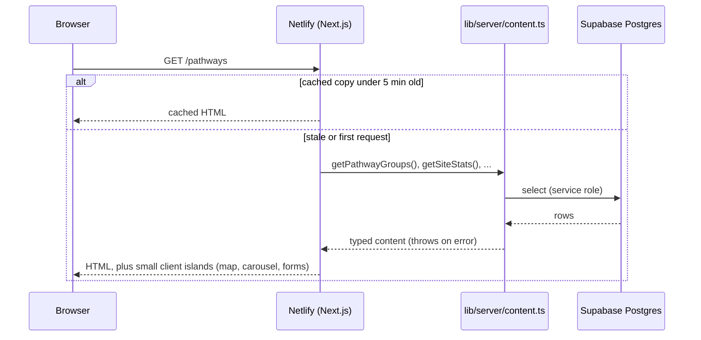
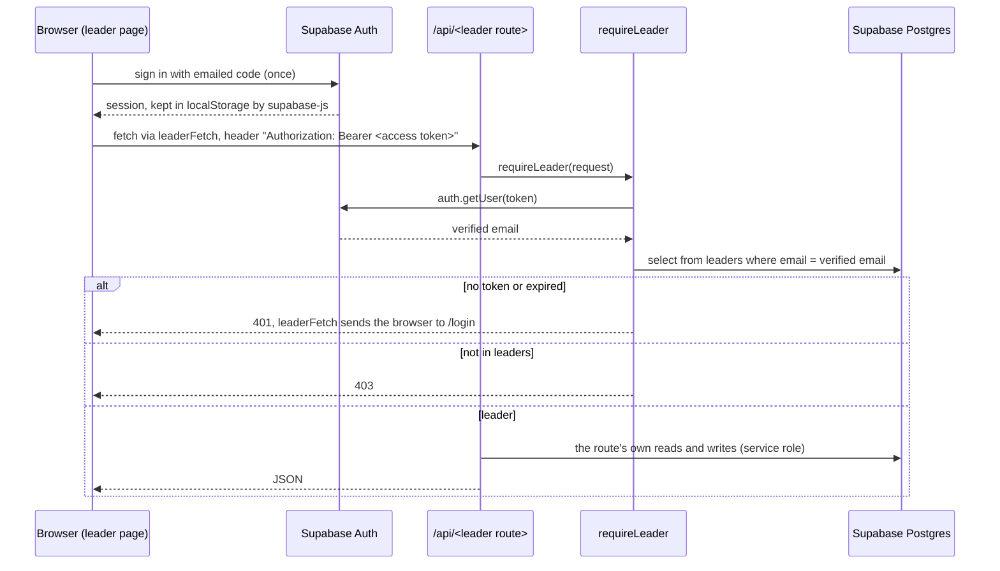
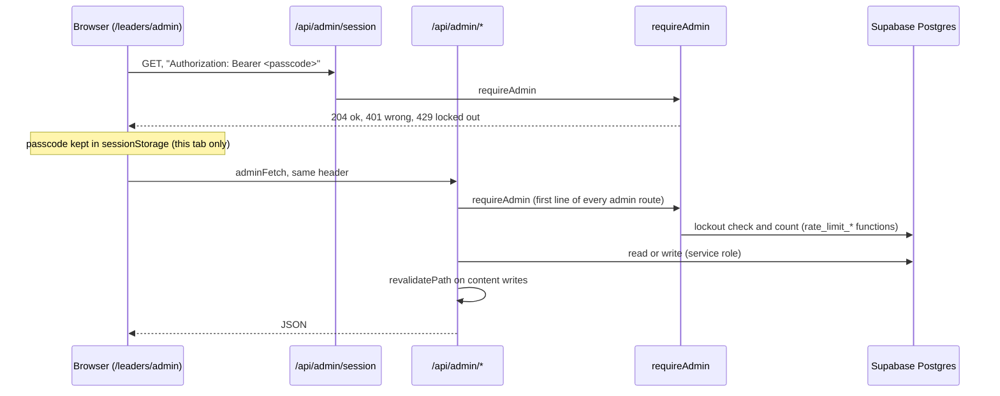
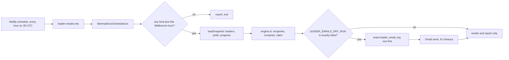

# Architecture

How a request moves through the Avenue site, where each kind of code lives, and what is cached.

## The big picture

- One Next.js 16 App Router app, hosted on Netlify.
- One Supabase project: Postgres for data, Supabase Auth for leader sign-in.
- **The browser never reads or writes a table.** Every table access is server code using the service role key through `getSupabaseAdmin()` (`src/lib/server/supabaseAdmin.ts`).
- The browser uses Supabase for one thing only: signing in and holding the session.
- One Netlify scheduled function (`netlify/functions/leader-emails.mts`) sends leader emails every hour.

## Request flows

### Public page (for example `/pathways`)

Public pages are Server Components. They read content on the server and are cached for 5 minutes (ISR: incremental static regeneration, meaning Next serves a saved copy and rebuilds it in the background).

- A read error throws. The page shows the `(site)/error.tsx` screen and ISR keeps the last good copy. There is no hard-coded fallback content.
- Public forms post to `POST /api/forms/[type]`, which saves the row, rate limits, and sends the emails. See [docs/security.md](docs/security.md).

### Leader page and leader API

Leader pages are client components under `src/app/leaders/`. `leaders/layout.tsx` is the one sign-in gate.

- The caller's email only ever comes from the verified token. Never from the body or query string.
- `/api/leader-access` and `/api/network` are read once per page load and shared between components (`src/lib/client/dedupeFetch.ts`).

### Admin

The admin page is `/leaders/admin`. It sits under the leader layout, so the browser must be signed in as a leader first. The admin API then needs the admin passcode.

- A content write calls `revalidatePath`, so the public page shows the change on the next request.

### Leader email engine

| Kind | When (Melbourne) |
|---|---|
| `rpms` | Sunday from 18:00 |
| `digest` | Monday from 07:00 |
| `church_health` | 1st of the month from 07:00 |
| `apprentice` | 15th of the month from 07:00 |
| `milestones` | Daily 07:00 to 09:00 |

- The unique `(email, kind, period_key)` row in `leader_email_log` stops double sends.
- At most 20 sends per run. A run stops claiming work after 20 seconds (Netlify stops it at 30).
- The function builds its own Supabase client: `getSupabaseAdmin()` would pull `next/server` into the bundle.

## Module boundaries

ESLint enforces these (`eslint.config.mjs`), by alias and by resolved path, so a relative import cannot slip past.

| Folder | May import | Must not import |
|---|---|---|
| `src/lib/domain/` | other domain files | React, Next.js, `@supabase/*`, `lib/server`, `lib/client`, `app/` |
| `src/lib/server/` | domain, supabase-js, Next server APIs | `app/`, `lib/client/supabaseBrowser` |
| `src/lib/client/`, `src/hooks/`, `src/components/` | domain, client code, `lib/emails/{prefs,topic,schedule}` | `app/`, `lib/server/*`, the rest of `lib/emails/*` |
| `src/app/api/**` | anything server side | `lib/client/supabaseBrowser` |
| `src/app/**/*.tsx` | guarded server modules | `lib/server/mail/*`, `lib/server/adminRead`, `lib/emails/*` (except the three shared files) |
| Everything under `src/lib/` | | `src/app/` |

**The `server-only` guard.** Every file in `lib/server/` starts with `import "server-only"`, so Next refuses to bundle it for the browser. The exceptions are `lib/server/mail/*`, `lib/server/adminRead.ts` and `lib/emails/*`: the Netlify function imports them in plain Node, where `server-only` throws. The lint rules above and `npm run check:function` guard those instead.

## Data model summary

22 tables in `public`. Full detail and a diagram: [docs/database.md](docs/database.md).

| Group | Tables |
|---|---|
| Training content | `training_video_questions`, `training_module_prompts` |
| Site content | `pathway_groups`, `intersection_events`, `intersection_event_dates`, `study_guides`, `site_stats` |
| Public input | `form_submissions`, `crossing_scores` (the Vision page game), `onramp_signups` (the On-Ramp sign-up page) |
| Leaders | `leaders` (the gate), `leader_profiles`, `leader_training_progress`, `leader_checkins`, `leader_people`, `leader_worksheets` |
| Network | `network_people` (the church-wide tree) |
| Emails | `leader_email_prefs`, `leader_email_log` |
| Workshops | `workshop_sessions`, `survey_responses` |
| Infrastructure | `rate_limits` |

## Caching model

| What | Cache | Refreshed by |
|---|---|---|
| Public pages in `(site)/` | ISR, `revalidate = 300` (5 min) | Time, or `revalidatePath` from an admin content write |
| `/api/*` responses | `Cache-Control: no-store` (next.config.ts) | Never cached |
| `/images/*` | 1 week, then stale-while-revalidate 1 day | Time. Filenames are not versioned |
| Leader pages | Not cached. Client-rendered after sign-in | Each page load |
| `/api/leader-access`, `/api/network` in the browser | Shared in-flight read per page load | Cleared on logout |

## Security headers

Set once for every path in `next.config.ts` from `src/lib/server/securityHeaders.ts` (Netlify ignores `netlify.toml` headers for pages Next renders). Details: [docs/security.md](docs/security.md).
