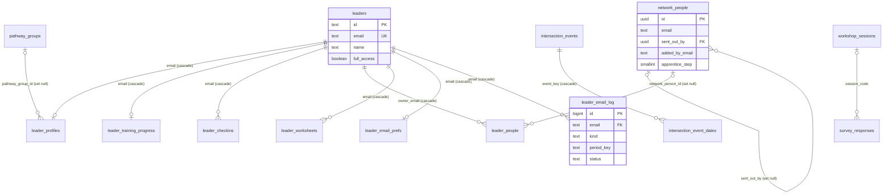

# Database

What is in the Supabase Postgres database, how the tables relate, who can touch them, and how to change them.

## The rules

- One Supabase project. No staging copy.
- **Only server code touches tables**, with the service role key through `getSupabaseAdmin()`. The service role bypasses RLS (row level security: per-row access rules in Postgres).
- Every table has RLS **on** with **no policies**. So the anon key (the one in the browser) can read and write nothing. Its only job is sign-in.
- Emails are stored lowercase and trimmed. The database refuses anything else (migration 013).
- Deleting a leader deletes their personal data by foreign key cascade (migration 014).

⚠️ Until `018_post_push_lockdown.sql` runs, the anon role still has old grants and five public read policies, kept for the old live code. See [deployment.md](deployment.md#4-lock-down-the-database-phase-b-only-after-step-3).

## Tables

| Table | What it holds | Key |
|---|---|---|
| `leaders` | Everyone who may sign in. `full_access` false = pending | `id` (text); `email` unique |
| `leader_profiles` | "My Profile": name, avatar, birthday, APEST, pathway group | `email` |
| `leader_training_progress` | Watched episodes, finished modules, checkpoint state, `revision` (stops lost updates) | `email` |
| `leader_checkins` | Weekly check-in scores (relational, physical, mental, spiritual) | `email` + `week_start` |
| `leader_people` | A leader's private list of people they are discipling | `id`; `owner_email` |
| `leader_worksheets` | One JSON document per leader per worksheet kind | `email` + `kind` |
| `leader_email_prefs` | Which leader emails are on, plus the unsubscribe token | `email` |
| `leader_email_log` | One row per email claimed for sending. Unique `(email, kind, period_key)` stops double sends | `id` |
| `network_people` | The church-wide "sent out by" tree, including people with no account | `id` |
| `pathway_groups` | Groups on the `/pathways` map | `id` |
| `intersection_events` | The three Intersection event types | `key` |
| `intersection_event_dates` | Upcoming dates per event | `id` |
| `study_guides` | Weekly pathways topics. `guide_on` is the date | `id` |
| `site_stats` | Counters on `/pathways` | `key` |
| `form_submissions` | Every public form, with its JSON `data` | `id` |
| `workshop_sessions` | Workshop room codes | `code` |
| `survey_responses` | One workshop survey answer set | `id` |
| `rate_limits` | Hit counters per rate-limit key and window | `key` |
| `crossing_scores` | Cross the Avenue leaderboard on `/vision`: three-letter initials, score, game length | `id` |
| `onramp_signups` | Avenue On-Ramp training day sign-ups (`/onramp`): name, email, 1 or 2 workshops. One row per email | `id`; `email` unique |

## Relationships

- `network_people.email` is **not** a foreign key to `leaders`: the tree includes people who never sign in.
- Foreign keys to `leaders(email)` also have `on update cascade`, so changing a leader's email carries through.

## Database functions

| Function | Used by | Notes |
|---|---|---|
| `rate_limit_hit(p_key, p_window_seconds, p_max)` | `allow()` in `lib/server/rateLimit.ts` | Counts a hit, returns true while under the limit |
| `rate_limit_blocked(p_key, p_window_seconds, p_max)` | `isBlocked()` | Read only |
| `worksheet_set_section(p_email, p_kind, p_section, p_value)` | `/api/worksheets` | Replaces one section of a worksheet. Security invoker |
| `set_updated_at()` | Triggers on the 7 tables with `updated_at` | Stamps the time on every update |

All are executable by the service role only (after 018).

## Migrations

There is no migration runner. Each file in `supabase/migrations/` is pasted into the Supabase SQL Editor and run once, in number order. Every file is idempotent (safe to run twice).

| File | What it does | Live |
|---|---|---|
| `legacy/schema-001.sql` | First schema. **Drops and recreates tables.** Only for an empty project | ✅ (long ago) |
| `002` to `009` | Leader profiles, network, training progress and revision, check-ins, My People, worksheets, leader emails | ✅ |
| `010_baseline_workshops` | Records the hand-made workshop tables | ✅ |
| `011_rate_limits` | `rate_limits` table and its two functions | ✅ |
| `012_updated_at_triggers` | One `set_updated_at()` trigger on 7 tables | ✅ |
| `013_email_checks` | Lowercase and trimmed email checks | ✅ |
| `014_leader_fks` | Foreign keys to `leaders(email)`, cascade | ✅ |
| `015_check_constraints` | CHECKs, defaults, NOT NULL | ✅ |
| `016_typed_columns` | `study_guides.guide_on` and `leader_profiles.pathway_group_id`, synced from the old text columns by triggers | ✅ |
| `017_indexes_invoker_and_submissions` | Two indexes, `worksheet_set_section` as invoker, drops the anon insert policy | ✅ |
| `018_post_push_lockdown` | Revokes all anon and authenticated access, drops the old text columns and sync triggers | ✅ |
| `019_crossing_scores` | `crossing_scores` table for the Vision page game. New table only, safe before the code is live | ✅ |
| `020_onramp_signups` | `onramp_signups` table for the On-Ramp sign-up page. New table only, safe before the code is live | ✅ |

### How to apply one

1. Back up every table (see [operations.md](operations.md#backups)).
2. Run `scripts/db/catalog.sql` in the SQL Editor. Save the output.
3. Run the migration.
4. Run `scripts/db/catalog.sql` again and compare.
5. `npm run guard` prints `clean`.

### How to write one

- Next number, short snake_case name: `019_what_it_does.sql`.
- Start with a comment block: what, why, and whether it is safe with the code that is live right now.
- Make it idempotent: `if not exists`, `drop ... if exists`, or check `pg_constraint` first.
- Wrap it in `begin; ... commit;` so an error changes nothing.
- New table: `enable row level security`, no policies, no anon grants.
- Add the table to `TABLES` in `scripts/db/export-tables.mjs` so backups include it.
